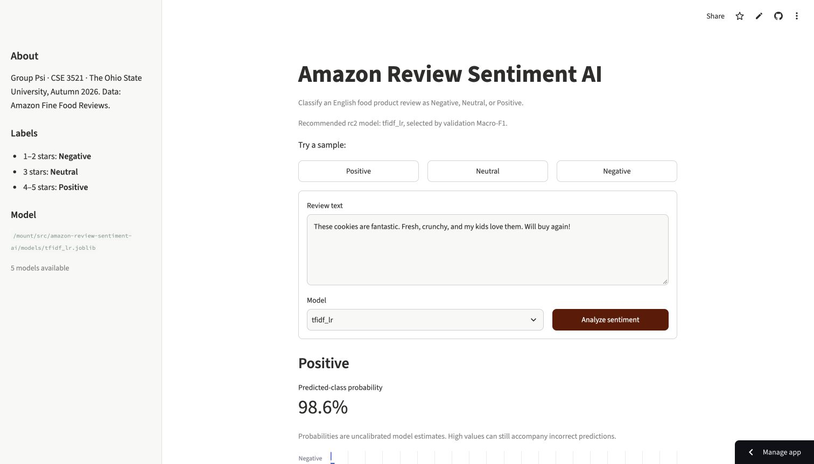
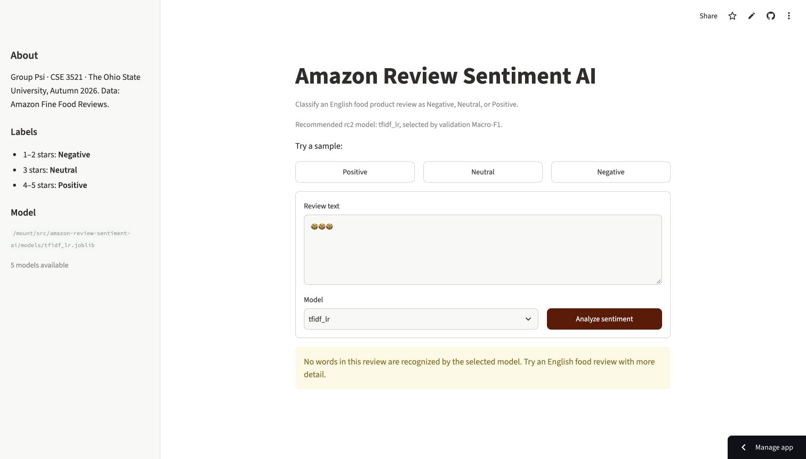
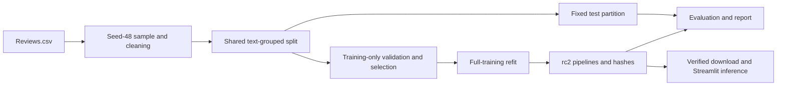

# Amazon Review Sentiment AI

**Five sentiment models, one reproducible comparison, and a live review classifier.**

[](https://github.com/its-spark-dev/amazon-review-sentiment-ai/actions/workflows/ci.yml)
[](#run-locally)
[](https://github.com/its-spark-dev/amazon-review-sentiment-ai/releases/tag/v0.2.0-rc2)
[](https://amazon-sentiment-ai.streamlit.app/)
[](LICENSE)

[**Try the app**](https://amazon-sentiment-ai.streamlit.app/) ·
[Results and protocol](docs/M3_RESULTS.md) ·
[Model card](docs/MODEL_CARD.md) ·
[Training guide](docs/M3_TRAINING.md) ·
[Portfolio review](docs/PORTFOLIO_READINESS.md)

Classify food reviews as **Negative, Neutral, or Positive** using Bag of Words
and TF-IDF with Multinomial Naive Bayes, Logistic Regression, and a small
feedforward MLP. This team project connects dataset preparation, training-only
validation, traceable evaluation, versioned model artifacts, and Streamlit deployment.

The main engineering lesson: **the model with the highest accuracy is not
necessarily the best choice for minority-class recognition.** TF-IDF LR is the
validation-selected recommendation; MLP has the highest observed test accuracy.
This is an educational ML demonstration, with the evaluation limits documented below.



*Actual main deployment, captured November 24, 2026 after PR #23 and a full
reboot. TF-IDF LR is the initial selection; probabilities are explicitly labeled
as uncalibrated estimates. This example's 98.6% is not test accuracy.*

<details>
<summary>Input guard example</summary>



*The selected model recognizes no vocabulary features, so the app shows an
explanation and withholds the label and probabilities. This is a vocabulary
check, not language or out-of-domain detection.*

</details>

## What is implemented

- **Training-only feature learning:** selection fits vocabulary/IDF on inner-fit
  rows; final refits use outer training and never the test set.
- **Explicit model selection:** LR settings and the MLP epoch are selected by
  validation Macro-F1, then refitted on outer training before test evaluation.
- **Reproducible handoff:** deterministic vocabulary tie handling, input/source/model
  hashes, loss history and measured environment versions in [provenance](docs/M3_RELEASE.json).
- **Release-backed inference:** five hash-verified pipelines, shared preparation/
  inference cleaning, input validation, model switching and cache invalidation.
- **Instant results:** about 1 s after typing stops, or as soon as another model is
  picked, the app predicts in the background and renders the result hidden in the
  page, chart included. **Analyze sentiment** then reveals it without waiting for
  the server; a click before anything is ready is computed as usual. See the
  [design and response-time benchmarks](docs/perf/INSTANT_RESULTS.md).
- **Automated checks:** synthetic unit, integration and browser tests; CI also
  checks lint, dependencies and tracked-file hygiene. Test success is not model-quality evidence.

## Current results: canonical rc2

A seed-48 sample of **50,000** Amazon Fine Food Reviews yields **46,278** cleaned
rows: **37,023 train / 9,255 test**. Grouping by identical cleaned text prevents
exact-text overlap. Inner fit/validation sizes are **29,622 / 7,401**.

| Model | Test accuracy | Macro precision | Macro recall | Macro-F1 |
| --- | ---: | ---: | ---: | ---: |
| Majority class | 77.97% | 0.2599 | 0.3333 | 0.2921 |
| BoW + Naive Bayes | 81.67% | 0.6103 | 0.6260 | **0.6177** |
| TF-IDF + Naive Bayes | 79.56% | 0.5468 | 0.3726 | 0.3647 |
| BoW + Logistic Regression | 83.51% | 0.6278 | 0.5808 | 0.5991 |
| TF-IDF + Logistic Regression | 76.93% | 0.5957 | **0.6838** | 0.6162 |
| TF-IDF + MLP | **84.01%** | **0.6374** | 0.5828 | 0.6021 |

**Recommendation:** TF-IDF LR (`C=0.5`, balanced weights) had the highest
validation Macro-F1, **0.6170**. On test, its Neutral recall is **54.52%**, versus
**19.21%** for MLP, with lower overall accuracy and Neutral precision. Test rankings
were not used to change that recommendation. The app initially selects `tfidf_lr`
when available and preserves your choice across reruns. In local mode, a single
`SENTIMENT_MODEL_PATH` override still takes precedence; without `tfidf_lr`, the
existing first available model is used.

All five trained models use 10,000 word-unigram features. The MLP has one hidden
layer of 32 ReLU units and uses validation-selected epoch 13. It does not model
word order. See [full results](docs/M3_RESULTS.md) for training times, per-class
metrics, confusion matrices and loss analysis. [Historical M2 results](docs/M2_BASELINE_RESULTS.md)
use 36,995 features and remain a separate experiment.
[Error analysis](docs/M4_ERROR_ANALYSIS.md) compares frozen rc2 error overlap,
class/length diagnostics and eight inspected paraphrases without retraining.

## Run locally

**Python 3.11.** The release demo needs no dataset or Kaggle credentials; first
launch needs package access and downloads the approved artifacts from GitHub.

```bash
git clone https://github.com/its-spark-dev/amazon-review-sentiment-ai.git
cd amazon-review-sentiment-ai
python3.11 -m venv .venv
source .venv/bin/activate
python -m pip install -r requirements.txt
MODELS_VERSION_TAG=v0.2.0-rc2 python -m streamlit run app.py
```

Open the printed local URL, normally `http://localhost:8501`. Enter an English
food review, choose a model, and click **Analyze sentiment**. Labels follow
ratings: **1–2 → Negative, 3 → Neutral, 4–5 → Positive**. To make the click
instant, the review text and model choice reach the app server about 1 s after
you stop typing (or when you switch models), before you click. The prediction is
kept in server memory for your session only and stays hidden until you click.

On Windows, create the environment with `py -3.11 -m venv .venv`, activate with
`.venv\Scripts\Activate.ps1`, install requirements, and run:

```powershell
$env:MODELS_VERSION_TAG="v0.2.0-rc2"
python -m streamlit run app.py
```

Without a release tag, the app discovers local `models/*.joblib` files and shows
a no-model notice on a fresh clone. `SENTIMENT_MODEL_DIR` changes that directory;
`SENTIMENT_MODEL_PATH` restricts **local mode** to one artifact. Release mode
lists only the five manifest-verified rc2 models. Only load trusted team artifacts.

For GitHub Codespaces, see the [development-container guide](.devcontainer/README.md)
for the protected forwarded-port launch and dataset-free rc2 demo command.

## Reproduce training

Download `Reviews.csv` from [Kaggle](https://www.kaggle.com/datasets/snap/amazon-fine-food-reviews)
and place it in `data/`. The [data guide](data/README.md) explains cleaning,
deduplication and grouped splitting. Dataset files and generated models stay local.

```bash
python scripts/make_group_sample.py
python scripts/clean_reviews.py
python scripts/split_reviews.py
python scripts/run_m3_comparison.py --output-dir outputs/m3/my-run
```

Use a new/empty output directory. The runner selects settings within training
and evaluates the supplied test split; it never resplits that test file.
A rerun's timings or serialized bytes can differ. The approved demo uses the
recorded rc2 artifacts, rather than silently replacing them with a rerun.
[Training details](docs/M3_TRAINING.md) · [M2 execution tools](docs/M2_ANALYSIS.md)



## Tests and CI

```bash
python -m pip install -r requirements-dev.txt
python -m pytest -m "not integration and not e2e"
python -m pytest -m integration
python -m playwright install chromium
python -m pytest -m e2e
ruff check .
```

Use `python -m pytest --cov` for the full suite with coverage. All tests use
synthetic inputs and temporary models, with no Kaggle data or external inference
service. The [workflow](.github/workflows/ci.yml) runs on pull requests and main
pushes. Development dependencies include the runtime requirements.

**Latest main validation:** [PR #27](https://github.com/its-spark-dev/amazon-review-sentiment-ai/pull/27)
merged at `0b85192` on November 24, 2026. All six
[CI jobs](https://github.com/its-spark-dev/amazon-review-sentiment-ai/actions/runs/45348633211)
passed: **195 tests** (136 unit, 42 integration and 17 browser), with no Node.js 20
deprecation warnings. This includes five development-container protection tests;
it does not verify a hosted Codespace or measure model performance.

## Evaluation limits

- Ratings supply the labels; they are not independent human sentiment annotations.
  Positive reviews are about 78% of the test set, so accuracy needs macro/per-class context.
- The test set was already inspected during M2 and reused for comparison. This is
  a single split/seed, with no confidence intervals or statistical superiority claims.
- Splits group exact cleaned text, not users, products, near-duplicates or time.
  Results do not establish generalization to unseen users/products or current reviews.
- English food-review text is the intended domain. BoW/TF-IDF pipelines withhold
  predictions when no vocabulary features are recognized after cleanup. This is
  a vocabulary check; partially recognized and out-of-domain inputs can still be wrong.
- “Predicted-class probability” displays the model's uncalibrated probability
  with one decimal place. High values can still accompany incorrect predictions.
  The demo is not a production monitoring or moderation system.

The [model card](docs/MODEL_CARD.md) describes the data, intended use and limits.
The [portfolio review](docs/PORTFOLIO_READINESS.md) records evidence and follow-up
work. The [frozen rc2 error analysis](docs/M4_ERROR_ANALYSIS.md) provides
retrospective diagnostics without changing the validation recommendation.

## Deployment

| Environment | Branch | Python | Model release |
| --- | --- | --- | --- |
| [Main demo](https://amazon-sentiment-ai.streamlit.app/) | `main` | 3.11.18 | `v0.2.0-rc2` |
| [Staging](https://amazon-sentiment-ai-preview.streamlit.app/) | `staging` | 3.14 | `v0.2.0-rc2` |

**Main verified November 24, 2026** after
[PR #23](https://github.com/its-spark-dev/amazon-review-sentiment-ai/pull/23)
merged at `9a29272` and the app was fully rebooted. A new session selected
`tfidf_lr`; the probability label, one-decimal display and uncalibrated-estimate
explanation were visible. Across all five models, 10 positive/negative predictions
matched canonical rc2 labels and displayed probabilities, 15 zero-feature probes
were withheld, and five valid-input recoveries passed. Empty and markup-only
input checks also passed. [Deployment verification details](docs/M3_RESULTS.md#hosted-main-status)

Staging's last recorded verification remains **November 23**: 14 hosted checks
with rc2. The November 24 serving update was verified on main only. These dated
checks are not an uptime guarantee or new model-performance measurements.
Configure the model tag separately in each app's Streamlit secrets editor;
branch merges do not transfer it. After serving-module changes, reboot and
verify behavior; automatic code refresh initially retained the old inference
behavior during this deployment.
Never commit `.env` or `.streamlit/secrets.toml`.

## Course and project status

**Group Psi · CSE 3521 — Survey of Artificial Intelligence I · The Ohio State
University · Autumn 2026 · Instructor: Dr. Thomas Torku**

Technical status as of **November 24, 2026**. Submission statuses remain those
last confirmed by the team; no new PDF submission is inferred:

| Milestone | Deadline | Status |
| --- | --- | --- |
| M1 — Project Charter & Scope | Nov 10 | **Submitted** |
| M2 — Initial Solution | Nov 15 | **Submitted** |
| M3 — Refined Solution & App Prototype | Nov 22 | Implementation and deployment verified; PDF update pending |
| M4 — Final Report & Presentation | Nov 29 (report) | Error-analysis materials ready; final report and presentation pending |

Report deadlines are 11:59 PM EST; M1 was extended from Nov 8 to Nov 10.
The team presentation plan is Dec 3; consult Carmen for the official demo schedule.
M3's technical and app work is complete; its remaining task is updating the PDF.
M4's final report and presentation are still outstanding; implementation completion
is not project completion.

## Team, attribution and contributing

| Member | Primary role |
| --- | --- |
| Zachary Funk | Project Lead |
| Sang Park | ML Engineer |
| Jacob Myers | App Engineer |
| Yash Amin | Analyst / Writer |
| Abderrachid Sghir | Data Engineer |

Roles follow the submitted M1 charter. Sang implemented ML training, evaluation,
analysis and model handoff work; Jacob contributed the Streamlit UI and shared
preparation scripts ([PR #7](https://github.com/its-spark-dev/amazon-review-sentiment-ai/pull/7),
[PR #8](https://github.com/its-spark-dev/amazon-review-sentiment-ai/pull/8)). Other
contributions remain credited through team reports and Git history. AI assistance
for implementation and draft technical notes is disclosed in [M2 results](docs/M2_BASELINE_RESULTS.md).
Final interpretation and writing are reviewed and owned by the team.

See [contribution guidelines](CONTRIBUTING.md) for focused branches, validation and
artifact handling.

## License

The contributors' original **code, documentation, figures, screenshots and
project-trained model artifacts** are covered by the [MIT License](LICENSE),
including the five approved rc2 pipelines. Preserve the MIT notice when
redistributing covered work. Existing model bytes and hashes are unchanged.

Amazon Fine Food Reviews is separate: [Kaggle](https://www.kaggle.com/datasets/snap/amazon-fine-food-reviews)
designates it **CC0: Public Domain**. Reviews and local dataset derivatives are
excluded from the project's MIT grant; datasets remain untracked. Third-party
dependencies and materials retain their own terms. See [licensing scope and
dataset attribution](docs/LICENSING.md) for details and the
[SNAP source](https://snap.stanford.edu/data/web-FineFoods.html) for the research citation.
