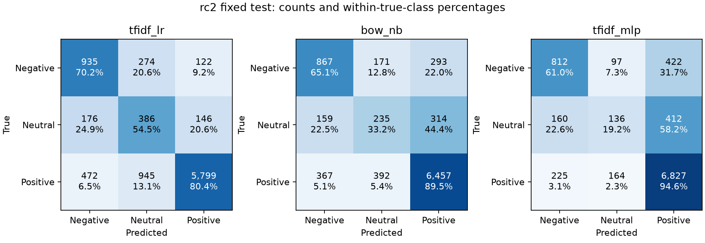
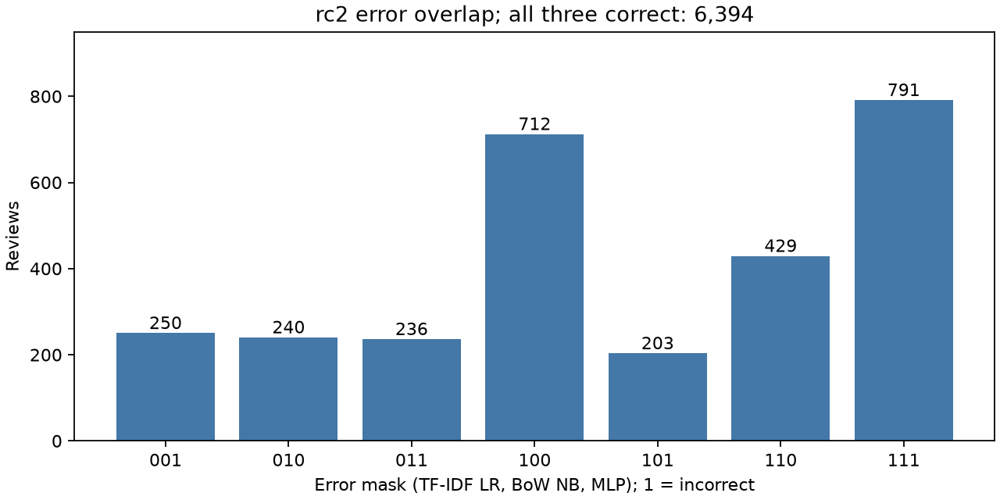
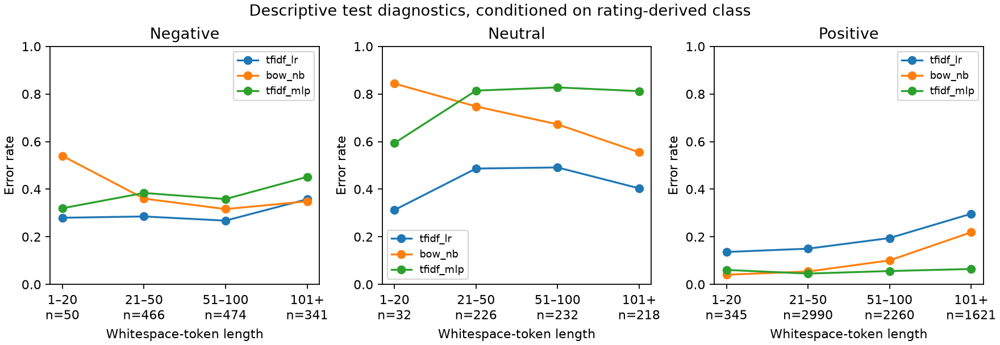

# M4: frozen rc2 error analysis

This report supplements [M3 results](M3_RESULTS.md), using **v0.2.0-rc2** only.
Revalidated November 24, 2026 against main `50587ac`.
No model was trained, tuned, selected, replaced or serialized. The original test
split, training procedure, and validation recommendation remain unchanged.
This is retrospective analysis of an already-inspected test set, not a new
prospective evaluation. It does not justify choosing settings on test results.

## Evidence and protocol

The analysis covers TF-IDF Logistic Regression (LR), BoW Multinomial Naive Bayes
(NB), and TF-IDF MLP on the same 9,255 test rows: 1,331 Negative, 708 Neutral,
and 7,216 Positive. Labels come from ratings (1–2 / 3 / 4–5), not independent
human annotation of textual sentiment. A text/label mismatch is therefore a
possibility to investigate, not automatically an incorrectly labeled review.

The script verifies the test CSV SHA-256 and all three approved model hashes,
then generates 27,765 predictions using the frozen pipelines and checks all
metrics against [M3_RELEASE.json](M3_RELEASE.json). An optional retained evaluation
export additionally checks row text/IDs/labels and every prediction. Both paths
were revalidated and reproduced the original aggregates exactly; all 27,765
exported predictions matched. It never calls fit or changes preprocessing.
Training data are not loaded.

This is **model.predict on canonical cleaned Text**, reproducing the reported
classifier scores. It does not apply the Streamlit input guard or measure app
coverage/abstention. The guard and probability wording added in PR #23 do not
change these frozen classifiers or their reported results. Aggregate counts and
provenance are in
[summary.json](m4_error_analysis/summary.json); raw reviews and identifiers remain
in ignored local outputs. All percentages below use the stated denominators.

## 1. Minority recall and majority errors explain the trade-off

| Model | Errors / 9,255 | Accuracy | Macro-F1 | Negative recall | Neutral precision | Neutral recall | Positive recall |
| --- | ---: | ---: | ---: | ---: | ---: | ---: | ---: |
| TF-IDF LR | 2,135 | 76.93% | 0.6162 | 70.25% | 24.05% | 54.52% | 80.36% |
| BoW NB | 1,696 | 81.67% | 0.6177 | 65.14% | 29.45% | 33.19% | 89.48% |
| TF-IDF MLP | 1,480 | 84.01% | 0.6021 | 61.01% | 34.26% | 19.21% | 94.61% |

LR correctly identifies 386/708 Neutral reviews, versus NB's 235 and MLP's 136.
However, it also predicts Neutral for 945 Positive reviews, versus 392 for NB
and 164 for MLP. Its lower accuracy must be read together with its higher
minority recall and low Neutral precision. MLP has the fewest total errors but
misses 572/708 Neutral reviews. All three remain below 55% Neutral recall.
NB has the highest observed test Macro-F1 among these models; LR remains the
**validation-selected recommendation**, not a model chosen from this error audit.
The MLP's nonlinear architecture does not establish universal superiority.



**Figure 1.** Frozen rc2 test confusion matrices. Rows are true rating-derived
labels, columns are predictions. Each cell shows its count and percentage of
that true class; diagonal values are recalls. Supports differ greatly by class.

## 2. Errors overlap, but models also disagree

The three models are all correct on 6,394 reviews and all incorrect on 791
(8.55% of the test set). At least one model is wrong on 2,861 reviews. Shared
failures include 283 Neutral, 256 Negative and 252 Positive reviews. Relative
to class support, these are 39.97%, 19.23% and 3.49%, respectively. This again
identifies Neutral as the largest shared challenge by rate, not just raw count.

| Wrong models (the others are correct) | Reviews |
| --- | ---: |
| MLP only | 250 |
| NB only | 240 |
| NB and MLP | 236 |
| LR only | 712 |
| LR and MLP | 203 |
| LR and NB | 429 |
| All three | 791 |

Of the 712 LR-only errors, 679 are Positive, 30 Negative and 3 Neutral.
LR and MLP predict different labels on 1,860 reviews: LR alone is correct on
486, MLP alone on 1,141, and both are wrong with different labels on 233.
These are paired descriptive counts, not independent samples, significance
tests, or measured ensemble performance. No ensemble was built or evaluated.



**Figure 2.** Error masks in LR/NB/MLP order: 1 means incorrect. Bars exclude
the 000 group (6,394 all-correct reviews). Counts sum to the 2,861-review union.

## 3. Length is not a universal explanation

Length is counted by whitespace in the supplied cleaned Text, not vocabulary
tokens. We use fixed descriptive buckets of 1–20, 21–50, 51–100 and 101+ words,
conditioning on the true class to avoid mixing Positive-heavy strata with
minority strata. Support is shown because some groups are small.

For Positive reviews, LR's error rate rises from 47/345 (13.62%) in the shortest
bucket to 481/1,621 (29.67%) in the longest; NB rises from 4.06% to 21.90%.
MLP's corresponding rates are 6.09% and 6.48%. In contrast, the 32 shortest
Neutral reviews have lower LR and MLP error rates than the 226 reviews in the
21–50 bucket. There is no common monotonic pattern supporting a claim that all
models fail primarily on short reviews. Length associations are exploratory:
they do not control for topic, vocabulary, sentiment mixture or duplicate groups,
and do not show that changing length would change a prediction.



**Figure 3.** Error rates within each true-class/length stratum. All models use
the same rows and denominator for each point. Numeric supports and error counts
are also exported in summary.json. These buckets were not used to tune models.

## 4. Eight manually inspected examples

These are **author-written paraphrases**, not quotations or new annotations.
We deliberately selected short, readable errors covering mixed sentiments,
shared failures and model disagreements after inspecting candidates. They are
illustrative, not a random sample and not estimates of pattern prevalence.
The true labels remain the dataset's rating-derived labels.

| Case | Paraphrased content | True | LR / NB / MLP | Interpretation |
| --- | --- | --- | --- | --- |
| E1 | Coffee is enjoyable, but damaged packaging makes some portions unusable. | Neutral | Neutral / Negative / Positive | Positive product opinion and negative delivery experience coexist; the models disagree across all three classes. |
| E2 | Tea tastes pleasant but does not deliver the expected energizing effect. | Neutral | Negative / Neutral / Positive | Taste and unmet expectations pull in different directions; only NB preserves the rating-derived Neutral label. |
| E3 | Cookies are visually appealing but bland, with another brand preferred. | Neutral | Negative / Negative / Negative | All models interpret the predominantly critical text as Negative despite the three-star label. |
| E4 | A reviewer reports that their pets became ill and stopped eating after trying treats. | Negative | Positive / Positive / Positive | A negative experience is missed by all three; this example does not establish product causality or identify which tokens caused the errors. |
| E5 | High expectations for tea are followed by disappointment in its bland taste and appearance. | Negative | Positive / Positive / Positive | Expectation versus experienced quality is a shared failure; positive expectation vocabulary may be relevant, but attribution was not tested. |
| E6 | Coffee is described as fresh and aromatic but excessively strong, with an explicit four-star qualification. | Positive | Neutral / Neutral / Neutral | A rating-positive review still contains a substantial reservation. The target is not a clean positive-only text label. |
| E7 | A gift is enthusiastically received and requested again; praise uses a negation-based construction. | Positive | Negative / Positive / Positive | LR misses the overall praise. Negation scope is a plausible hypothesis, not a demonstrated cause from one example. |
| E8 | A reviewer praises a refill product while reporting fewer items than expected. | Positive | Negative / Negative / Positive | The complaint dominates LR/NB predictions, while MLP matches the Positive rating. This complements cases where MLP misses criticism. |

The recurring observation in these inspected cases is **mixed product, delivery,
price or expectation sentiment within one review**. Unigram representations do
not explicitly encode clause order, negation scope or which aspect a phrase
describes. A nonlinear MLP over unigrams does not recover that sequence input.
These examples motivate hypotheses about missing context and rating/text
alignment, not proof that these mechanisms cause a known fraction of all errors.
We did not measure a sarcasm category or relabel ambiguous reviews.

Potential future work includes negation-aware n-grams, aspect/sentence-aware
representations, training-only imbalance strategies, and a separately specified
human annotation audit. Any choice must be developed on inner validation and
evaluated with a properly reserved evaluation protocol. None was implemented
here, and no new performance gain is claimed. Freezing rc2 avoids retrospectively
optimizing the already-inspected shared test set.

## Reproduce and use for the M4 report

Use Python 3.11 and install `requirements-dev.txt` as described in the README.
Obtain `Reviews.csv` from [Kaggle](https://www.kaggle.com/datasets/snap/amazon-fine-food-reviews)
and follow the [data guide](../data/README.md) to reproduce the seed-48 sample,
cleaning and shared split. If the canonical `data/test_reviews.csv` already
exists, preserve it. Its hash must match M3_RELEASE.json; do not resplit or
substitute a new test set when validation fails.

Only the canonical test CSV and approved release models are required. Download
the hash-verified rc2 assets into an ignored directory, then run **prediction and
analysis only**, without the training runner or any private evaluation export:

```bash
python -c "from inference import ensure_models_release; ensure_models_release('v0.2.0-rc2', 'outputs/m3/m4-models')"
python scripts/analyze_m4_errors.py --run-dir outputs/m3/m4-models \
  --test data/test_reviews.csv --output-dir outputs/m3/m4-error-analysis-new \
  --case-indices 40 178 204 202 648 16 85 164
python -m pytest tests/test_m4_errors.py
```

Choose a new or empty output directory. For contributors retaining the original
run, `--run-dir outputs/m3/release-rc2` reuses the same approved artifacts. Adding
`--evaluation outputs/m3/release-rc2/evaluation/analysis.json` cross-checks that
local export's provenance, row alignment and predictions; an inconsistent export
fails validation. This optional file contains real review text and is not
published in Git or release assets. No-export and export-checked runs reproduce
identical aggregates; `evaluation_sha256` is null when no export is supplied.

The November 24 verification reproduced every published aggregate, all eight
case mappings and pixel-identical versions of the three figures. Synthetic tests
also cover both execution paths, artifact/test/metric mismatches and malformed
exports. All 190 tests passed locally, including 14 focused error-analysis tests
and 17 browser tests. CI tests require no Kaggle data or external services.

Subsequently, [PR #27](https://github.com/its-spark-dev/amazon-review-sentiment-ai/pull/27)
merged at `0b85192` and all six
[main CI jobs](https://github.com/its-spark-dev/amazon-review-sentiment-ai/actions/runs/45348633211)
passed with **195 tests** (136 unit, 42 integration and 17 browser). The five added
tests cover development-container protection; they do not change the frozen
analysis, figures, models or earlier 190-test reproduction record above.

The indices are zero-based **test-row positions**, not Amazon review IDs; their
order defines E1–E8. Full texts, IDs and predictions for auditing are written to
cases.local.json under the ignored output directory. It must be new or empty.
Custom output locations must also remain local: they are not automatically
ignored. Do not commit raw case files or upload the evaluation JSON.

Tracked figures and summary.json contain only aggregates and hashes. To refresh
them, run the analysis in a new ignored output directory, then copy only the three
PNGs and summary.json into docs/m4_error_analysis/. If provenance validation
fails, investigate the mismatch; do not retrain or substitute models silently.
For M4's 2–3 page Models and Results section, reuse the M3 full comparison table,
Figure 1 and selected illustrative cases, with the selection and test-reuse
caveats. Figures 2–3 and the complete cases can go in the optional appendix.
